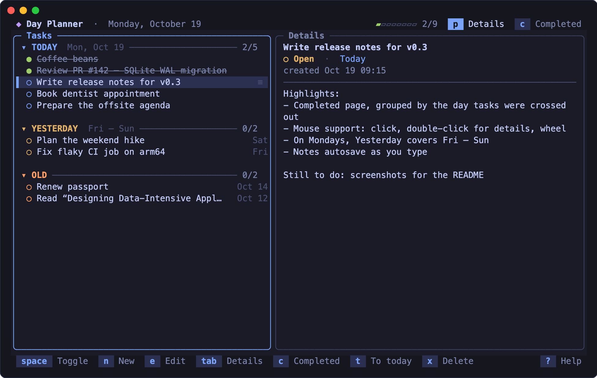
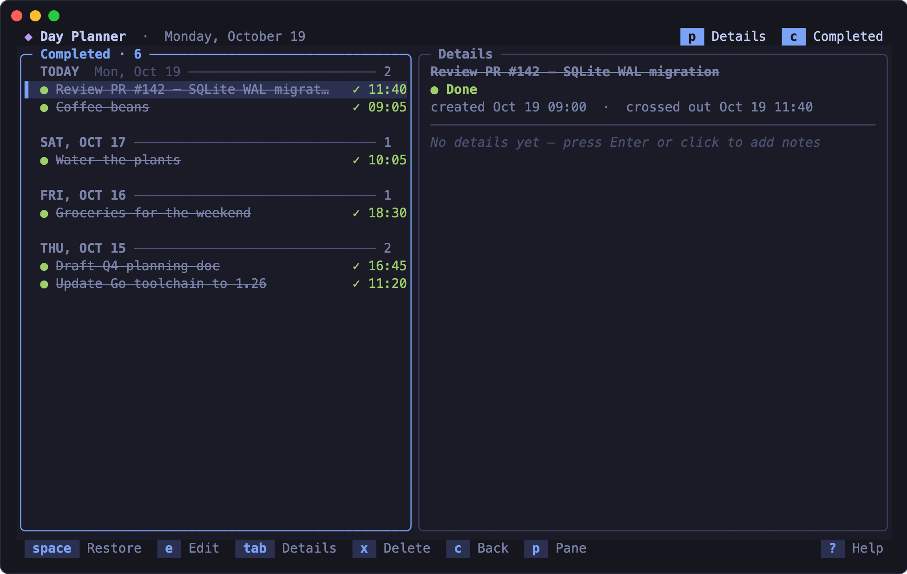
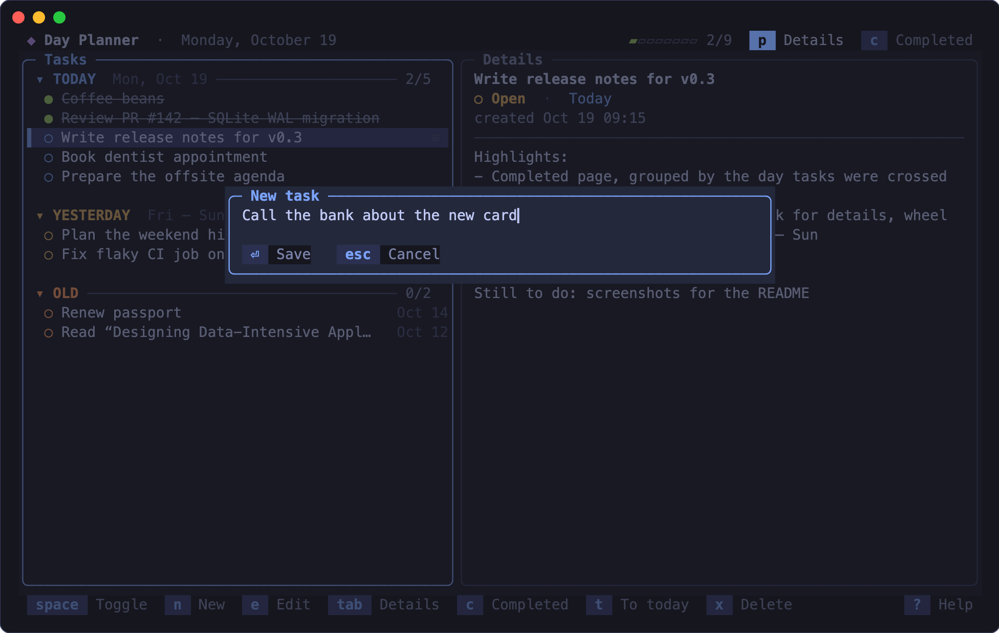

# Day Planner

A small, fast to-do list for the terminal, organized by day. Add tasks to **Today**, cross them off, and keep notes on each one. Tasks you didn't finish stay on your list, sorted into **Yesterday** and **Old**.



## Features

- **Day sections.** New tasks go into Today. Unfinished tasks move to Yesterday and then to Old as the days pass. On Mondays, Yesterday covers Friday through Sunday. Press `t` to move a task back to Today.
- **Notes for every task.** The details pane is a multi-line editor that saves as you type.
- **Completed page.** Crossed-out tasks stay in Today until midnight. After that, they're kept on the Completed page, grouped by the day you finished them, and you can restore any of them.
- **Keyboard and mouse.** Vim-style keys, plus clicking, double-clicking and scrolling with the mouse wheel.
- **Single binary, no daemon.** Tasks are stored in a local SQLite file using a pure-Go driver (no cgo). If you open the planner in two terminals, each one picks up changes from the other within a second.

<table>
  <tr>
    <td></td>
    <td></td>
  </tr>
  <tr>
    <td align="center">Completed page</td>
    <td align="center">Adding a task</td>
  </tr>
</table>

## Install

Requires Go 1.26+. Runs on macOS and Linux.

```sh
git clone git@github.com:tryshchenko/tui-day-planner.git
cd tui-day-planner
go build -o day-planner .
./day-planner
```

## Keys

| Key | Action |
| --- | --- |
| `↑` `↓` / `j` `k` | Move selection |
| `g` / `G` | First / last task |
| `space` | Cross out / un-cross a task (restores it on the Completed page) |
| `n` / `a` | New task (added to Today) |
| `e` / `F2` | Edit title |
| `t` | Move task to Today |
| `x` / `Del` | Delete task |
| `z` | Fold / unfold section |
| `tab` / `enter` | Focus the details pane to edit notes |
| `esc` / `tab` | Back to the task list |
| `ctrl+s` | Save notes now (they also autosave) |
| `p` | Show / hide the details pane |
| `c` | Completed page |
| `?` | Help |
| `q` / `ctrl+c` | Quit (`q` goes back from Completed) |

Mouse: click to select, double-click to open details, click a circle to toggle the task, scroll with the wheel.

## Data

Tasks are stored in `~/.day-planner.db`. To use a different file, set `DAY_PLANNER_DB`:

```sh
DAY_PLANNER_DB=~/work-tasks.db ./day-planner
```

## Development

```sh
go test ./...
```

The screenshots above are generated from the real renderer with demo data. To regenerate them (requires Google Chrome):

```sh
./docs/screenshots/render.sh
```
